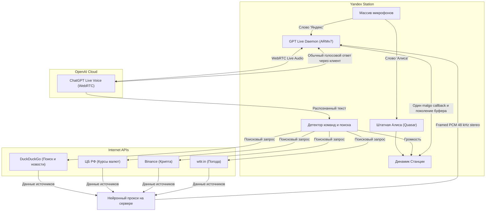

# 🎙️ GPT Live на Яндекс Станции (Мини 1 и Мини 2)

<p align="center">
  
  
  
  
  
</p>

Полноценный голосовой диалог с **ChatGPT в реальном времени (WebRTC Live Voice)** на умной колонке **Яндекс Станция Мини 1** (`YNDX-0004`) и **Мини 2**.

Клиент работает на самой колонке, сохраняет штатную Алису и управляет физической громкостью динамика. Обычный `/wm`-диалог использует выбранный голос ChatGPT; для озвучки локальных веб-инструментов теперь нужен **потоковый нейронный TTS-прокси на домашнем сервере/VPS**. Его голоса Svetlana/Dmitry не являются голосом Vale.

Подробности: [проверка протокола и архитектуры](<docs/SEAMLESS_VOICE_REVIEW.md>), [проверка на устройстве по ADB](<docs/ADB_NEURAL_TTS_VERIFICATION.md>), [настройка прокси](<services/neural-tts/README.md>). Без приватной конфигурации нейронной озвучки обычный голосовой диалог остаётся доступен, но локальные инструменты не озвучиваются. Для этих изменений нужно пересобрать ARM-клиент; старый готовый бинарник их не содержит.

---

## ✨ Ключевые возможности

- 🗣️ **Два голосовых помощника одновременно:**
  - Скажите **«Яндекс»** — включится живой ChatGPT.
  - Скажите **«Алиса»** — откликнется штатная Алиса (музыка, радио, таймеры, умный дом Яндекса).
- ⚡ **Прямой WebRTC-диалог:**
  - Речь передаётся в голосовой движок OpenAI. Ранний локальный детектор энергии и поколение буфера помогают прерыванию; задержку и акустический хвост нужно измерить на устройстве.
- 🌐 **Локальные инструменты со streaming neural TTS:**
  - Станция классифицирует завершённую фразу и получает данные:
    - **USD, EUR, CNY:** справочный курс с зеркала ЦБ РФ с датой публикации, не банковский курс покупки/продажи.
    - **BTC и ETH:** котировки Binance с явным обозначением USDT и времени получения.
    - **Погода:** Open-Meteo, проверка полей/дат и ограниченный прогноз; резервный `wttr.in` только для текущей погоды.
    - **Новости и свободный поиск:** фрагменты DuckDuckGo с предупреждением о непроверенной актуальности; без подмены свежих новостей Википедией.
  - Ошибка источника не выдаётся за успешный доступ к свежим данным. Озвучку выполняет настроенный нейронный прокси, без старого Google MP3/aplay-фоллбэка.
- 🎚️ **Нативное управление громкостью колонки:**
  - ChatGPT понимает голосовые команды громкости и физически регулирует звук на динамике:
    - Шкала Станции от 1 до 10: *«громкость 5»* (50%), *«громкость 8»* (80%), *«на семь»*.
    - Проценты: *«громкость 40%»*, *«звук на 70»*.
    - Относительные команды: *«сделай потише»*, *«погромче»*, *«прибавь звук»*.
    - Пресеты: *«на максимум»*, *«на минимум»*, *«выключи звук»*, *«без звука»*.
- 🔊 **Unity gain и штатная VQE/AEC:**
  - Программное усиление +5 dB не применяется; реальные уровни и работу эхоподавления нужно проверить на колонке.
- 💳 **Без платного OpenAI API:**
  - Использует сессию вашего собственного аккаунта [chatgpt.com](https://chatgpt.com/), без developer API key. Доступность моделей/голосового режима и квоты конкретного Free/Plus-аккаунта нужно проверять отдельно.
- 🧩 **Целевой ARMv7 hard-float / glibc 2.23:**
  - Флаги сборки не доказывают совместимость ядра, платы, libc и нативной прошивки. Перед установкой сверьте фактическое устройство по ADB; инструкции для другой платы применять нельзя.

---

## 🏗️ Архитектура решения



---

## 📋 Что потребуется

1. **Колонка:** Яндекс Станция Мини 1 (`YNDX-0004`) с датчиком жестов сверху, либо Станция Мини 2.
2. **Кабель USB Type-C:** качественный провод **с линиями передачи данных** (комплектный провод питания не подходит, нужен дата-кабель от смартфона).
3. **Компьютер:** под управлением Windows 10/11 x64, macOS или Linux.
4. **Аккаунт на [chatgpt.com](https://chatgpt.com/):** перед началом убедитесь, что в веб-браузере на ПК у вас работает режим Voice.
5. **Доступ в интернет на Станции:** если в вашей стране OpenAI заблокирован, трафик Станции должен идти через VPN (например, настроенный на роутере).

---

## 🚀 Пошаговая инструкция: От А до Я

### Шаг 1. Получение Root-прав на Станции Мини 1

> Если ваша колонка уже рутирована (доступен `adb shell` под `root`), переходите к **Шагу 2**.

Для Яндекс Станции Мини 1 (YNDX-0004, процессор Amlogic A113X) не требуется пайка или разборка:
1. Скачайте утилиту **StationMiniRoot** (версия `0.3.15` или новее).
2. Запустите `StationMiniRoot.exe` и нажмите **«Установить все зависимости»** (установит драйверы Amlogic и компоненты WSL).
3. **Отключите питание от колонки**.
4. Вставьте дата-кабель Type-C в колонку и подключите к USB-порту компьютера (кнопки зажимать не нужно — колонка определится в сервисном режиме `1B8E:C003`).
5. Нажмите **«Установить root»**:
   - Программа сделает полный резервный бэкап системы (80 МБ);
   - Внедрит ключ авторизации ADB и включит `adbd` от root;
   - Заблокирует автоматические обновления (OTA);
   - Перезагрузит колонку.
6. Подробное иллюстрированное руководство доступно в [docs/ROOT_GUIDE_MINI1.md](docs/ROOT_GUIDE_MINI1.md).

---

### Шаг 2. Освобождение слова-активатора «Яндекс»

1. Откройте приложение **«Дом с Алисой»** на смартфоне.
2. Перейдите в настройки вашей Станции Мини.
3. В пункте **«Имя помощника»** выберите **«Алиса»**.
4. Теперь имя **«Яндекс»** свободно для запуска ChatGPT!

---

### Шаг 3. Проверка подключения по ADB

Убедитесь, что колонка подключена по USB к компьютеру, либо подключитесь по Wi-Fi:

**Windows (1-клик):**
Запустите `scripts\windows\01-check-station.bat`

**Командная строка (любая ОС):**
```bash
adb devices
adb shell id
```
Ответ должен содержать: `uid=0(root)`.

*Если вы хотите подключаться по Wi-Fi без провода:*
```bash
# Узнайте IP-адрес Станции в локальной сети:
adb shell "ip route get 1.1.1.1 | awk '{print \$7}'"
# Подключитесь по воздуху (замените IP на ваш):
adb connect 192.168.1.100:5555
```

---

### Шаг 4. Установка клиента GPT Live на Станцию

Выполните `make build`, затем используйте проверяемую установку `make install`. Старый готовый бинарник не содержит новых изменений нейронной озвучки; совместимость новой сборки нужно проверить на фактическом устройстве по ADB.

#### Способ А. Автоматическая установка в 1 клик (Windows):
Запустите скрипт:
```cmd
scripts\windows\03-deploy-client.bat
```
Скрипт автоматически загрузит бинарник в `/data/yandex-station-chatgpt-voice/client`, выставит права `755` и настроит скрипты автозапуска.

#### Способ Б. Через командную строку (Linux / macOS):
```bash
./scripts/deploy.sh
```

---

### Шаг 5. Авторизация в ChatGPT (без платного API)

Вам не нужен платный API ключ. Достаточно один раз войти в свою учетную запись через вспомогательный скрипт:

#### Windows (1-клик):
Запустите `scripts\windows\02-login-chatgpt.bat`

#### Linux / macOS:
```bash
python3 tools/station.py login --browser=chrome
```

**Что произойдёт:**
1. Откроется чистое окно браузера Chrome на странице [chatgpt.com](https://chatgpt.com/).
2. Войдите в свой обычный аккаунт OpenAI.
3. Как только загрузится интерфейс чата, скрипт автоматически перехватит токен веб-сессии и сохранит его на колонку в `/data/yandex-station-chatgpt-voice/session.json`.
4. Служба на колонке перезапустится и будет готова к общению!

---

### Шаг 6. Проверка и голосовой диалог!

1. Скажите колонке: **«Яндекс»**.
2. Колонка издаст короткий высокий звуковой сигнал готовности (880 Гц).
3. Говорите! Например:
   - *«Привет! Как твои дела?»*
   - *«Какой сейчас курс доллара?»* ➔ колонка мгновенно запросит данные ЦБ РФ и назовёт курс!
   - *«Какая погода в Москве?»* ➔ ответит актуальным прогнозом погоды!
   - *«Сделай потише»* / *«Громкость 6»* ➔ физически изменит громкость на Станции!
   - *«Посмотри в DuckDuckGo свежие новости»* ➔ найдёт главные события сегодняшнего дня!
4. Когда вы закончите диалог (или попрощаетесь словами *«Пока»* / *«Хватит»*), колонка издаст низкий сигнал (440 Гц) и вернётся в режим ожидания.

---

## 🛠️ Голосовые команды и возможности

| Команда / Фраза | Что делает колонка |
|---|---|
| **«Яндекс»** | Активация ChatGPT Live (высокий сигнал 880 Гц) |
| **«Алиса»** | Активация стандартной Алисы (музыка, умный дом) |
| **«Какой курс доллара / евро / юаня?»** | Запрос к API ЦБ РФ, озвучка точного курса валюты |
| **«Сколько стоит биткоин?»** | Запрос к Binance, озвучка курса BTC/USDT |
| **«Какая погода в [городе]?»** | Запрос к `wttr.in`, температура, ветер, осадки |
| **«Посмотри в DuckDuckGo [запрос]»** | Полноценный веб-поиск через DuckDuckGo POST |
| **«Что произошло 13 ноября?»** / **«Свежие новости»** | Поиск новостей и событий сегодняшнего дня |
| **«Сделай потише / погромче»** | Изменение громкости на ±15% |
| **«Громкость [1-10]»** (*«громкость 6»*, *«на пять»*) | Установка громкости по шкале Яндекс Станции (10–100%) |
| **«Громкость [число]%»** (*«громкость 45%»*) | Точная установка громкости в процентах |
| **«На максимум»** / **«На минимум»** | Установка громкости 100% или 10% |
| **«Выключи звук»** / **«Без звука»** | Громкость 0% |
| **«Пока»** / **«До свидания»** / **«Отбой»** | Завершение сессии диалога |

---

## 📋 Управление службой и просмотр логов

### Просмотр логов в реальном времени:
**Windows:** запустите `scripts\windows\04-live-logs.bat`  
**Linux / macOS:** `./scripts/logs.sh`  
Или через ADB:
```bash
adb shell "tail -f /tmp/yandex-station-chatgpt-voice.log"
```

### Перезапуск службы:
**Windows:** `scripts\windows\05-restart-service.bat`  
**Linux / macOS:** `./scripts/restart.sh`

### Структура файлов на Станции:
- `/data/yandex-station-chatgpt-voice/client` — исполняемый бинарник
- `/data/yandex-station-chatgpt-voice/session.json` — сохранённый токен сессии
- `/data/yandex-station-chatgpt-voice/start.sh` — стартер демона
- `/tmp/yandex-station-chatgpt-voice.log` — файл журнала

---

## 🔨 Сборка из исходников (для разработчиков)

Для кросс-компиляции под 32-битный ARMv7 с поддержкой старых версий glibc (2.23) используется компилятор **Zig**:

### Сборка через WSL / Linux:
```bash
# 1. Установите зависимости:
sudo apt-get update
sudo apt-get install -y git make curl python3 pkg-config libopus-dev
curl -LsSf https://astral.sh/uv/install.sh | sh

# 2. Клонируйте репозиторий:
git clone https://github.com/HazloNazlo/yandex-station-chatgpt-voice.git
cd yandex-station-chatgpt-voice

# 3. Запустите сборку для ARM:
./tools/build-arm.sh build
```
Готовый бинарник будет сохранён в `build/yandex-station-chatgpt-voice`.

---

## ❓ Часто задаваемые вопросы (FAQ & Troubleshooting)

<details>
<summary><b>1. Говорю «Яндекс», колонка издаёт сигнал, но ChatGPT молчит или сразу завершает звонок</b></summary>

- **Причина:** Истёк срок действия токена сессии `session.json`, либо у колонки нет выхода в интернет к `chatgpt.com`.
- **Решение:** 
  1. Запустите авторизацию заново через `scripts\windows\02-login-chatgpt.bat`.
  2. Проверьте пинг и доступность серверов OpenAI с колонки:
     ```bash
     adb shell "wget -q -O - https://chatgpt.com/ | head -n 5"
     ```
  3. Если в вашей стране OpenAI заблокирован, убедитесь, что роутер направляет трафик Станции через VPN.
</details>

<details>
<summary><b>2. ChatGPT говорит, что у него нет доступа в интернет</b></summary>

- **Причина:** Серверная модель OpenAI не знает, что работает на Яндекс Станции, и по умолчанию считает, что у неё нет браузера в голосовом режиме.
- **Решение:** Формулируйте запрос с указанием поиска: *«Посмотри в DuckDuckGo ...»*, *«Найди в интернете ...»*, *«Какой курс доллара?»*, *«Какая погода?»*. Станция сама перехватит запрос, за доли секунды получит данные из сети и передаст их модели.
</details>

<details>
<summary><b>3. Не слышит слово «Яндекс» или путает с Алисой</b></summary>

- Убедитесь, что в приложении «Дом с Алисой» для колонки выбрано имя **«Алиса»**.
- Если на колонке громко играет музыка, говорите громче или используйте жест паузы сверху.
</details>

<details>
<summary><b>4. Как вернуть колонку к заводскому состоянию?</b></summary>

- Используйте сохранённый дамп `system_backup.img` из папки бэкапов утилиты StationMiniRoot и прошейте его через опцию «Восстановить бэкап».
</details>

---

## 📄 Лицензия

Проект распространяется под свободной лицензией **MIT**. Исходный протокол основан на наработках `hu553in/yandex-station-chatgpt-voice`. Доработки для Станции Мини 1, поддержка glibc 2.23, динамическое усиление звука (+5 dB), нативный регулятор громкости и поиск через DuckDuckGo / ЦБ РФ / Binance / wttr.in реализованы для сообщества владельцев Яндекс Станций.

---

<p align="center">
  Сделано с ❤️ для умных колонок Яндекс Станция.
</p>
