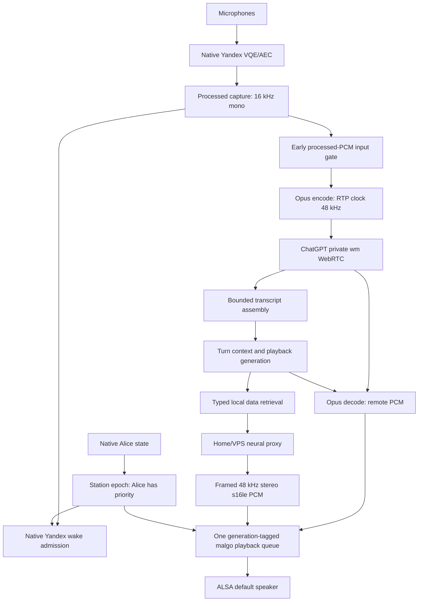

# Station voice architecture

The client keeps native Alice priority while using a personal ChatGPT web session for ordinary `/wm` voice conversation. Local tool answers use an explicitly configured neural TTS proxy; they are not relayed into the autonomous `/wm` answer. This does not preserve the selected ChatGPT voice for local answers.

See the detailed [protocol and architecture review](<SEAMLESS_VOICE_REVIEW.md>), [ADB verification procedure](<ADB_NEURAL_TTS_VERIFICATION.md>), and [proxy setup](<../services/neural-tts/README.md>). Private protocol capabilities and hardware compatibility require evidence, not assumptions from a public Realtime API or a target compiler flag.

## Audio and native ownership

Capture is 320 samples/20 ms at 16 kHz mono; playback is 960 frames/20 ms at 48 kHz stereo. The 48 kHz Opus RTP clock must not be confused with microphone sample rate. Software playback gain is unity so native AEC does not have an unverified +5 dB/clipping change to compensate for.

The Station epoch revokes capture/playback and cancels the peer when native Alice takes priority. Only the device callback owns its partially consumed PCM block; new turn generations invalidate that block as well as the channel queue. Existing short wake/end cue subprocesses remain separate from the spoken-answer pipeline.

## Turn classification and local speech

1. An early processed-PCM RMS trigger holds remote playback before the corresponding microphone frame is encoded/sent. This gate is a calibratable energy detector, not guaranteed speech recognition.
2. The completed user transcript selects an ordinary or local-tool turn. Transcript parsing is bounded and supports inspected repository shapes, not every possible future/interleaved protocol event.
3. Ordinary turns release retained remote audio. A full pending buffer fails closed rather than losing the beginning of the answer.
4. Local turns discard held remote audio and claim one playback generation. Retrieval, HTTP streaming, queued audio, and drain work belong to that turn context.
5. The proxy streams Edge MP3 through off-device ffmpeg and returns length-prefixed PCM. The speaker performs no neural inference, MP3 decoding/resampling, or separate TTS `aplay` playback.
6. The consumer requires the application success marker, clean HTTP EOF, and callback drain. Completion retires local ownership to **blocked**, never timer-unmuting the discarded remote answer.
7. New input cancels old work and begins a new generation. Stale completion/cancellation and worker registration are serialized against current input and peer teardown.

Normal remote admission remains 12 full blocks/240 ms. Pending hold and its bounded release/continuation can use 50 full blocks/1 second until the backlog drains; local speech uses at most eight full blocks/160 ms with backpressure, not lossy overflow. Hardware/ALSA buffering adds an unmeasured acoustic tail.

Remote RTP has no verified user-turn identifier. The client rejects packets/PCM it already buffered under old generations, but cannot perfectly attribute old server audio arriving after new input. For a strict session boundary use a validated server acknowledgement or close/recreate the connection. The optional observed private `stop_speaking` action is off by default and is not presented as a verified cancellation contract.

## Tools and external services

- CBR mirror: dated reference USD/EUR/CNY rates, normalized nominal and rounded cents; not bank buy/sell or stock prices.
- Binance: BTC/ETH exact pair validation, positive finite quote, explicit USDT/venue/receipt-time labeling.
- Open-Meteo: validated geocoding, current values and dated limited forecasts. Missing/null values are not zero. Current-only wttr fallback cannot substitute for a failed future-date forecast.
- News/search: bounded snippets with a fact/date-verification warning. Freshness failures do not become Wikipedia results claimed as current news.
- Page reading: existing SSRF protections remain. External content is data, not execution instructions.
- Volume: existing native hardware helper and percent/relative commands; local acknowledgement uses the configured neural voice.

The [Go consumer](<../internal/voice/speech.go>) reads an optional private local configuration, independently authenticated from ChatGPT. The [proxy](<../services/neural-tts/README.md>) accepts only bounded plain text and Svetlana/Dmitry voices. It has bounded concurrency/deadlines/pipe processing, cancellation-safe process ownership, and a mandatory framed success marker. Edge is unofficial, without SLA, and does not provide Vale.

## Native-voice upgrade path

The strongest same-voice candidate is Codex app-server realtime with native handoff, `item/tool/call`, and `thread/realtime/appendSpeech`. That is a separate control/tool protocol while validated WebRTC media can remain Station-to-OpenAI. A Free-account non-voice diagnostic is not voice entitlement. The [review](<SEAMLESS_VOICE_REVIEW.md>) lists the exact inspected flow and promotion gates; no working Station native bridge is claimed in this delivery.
